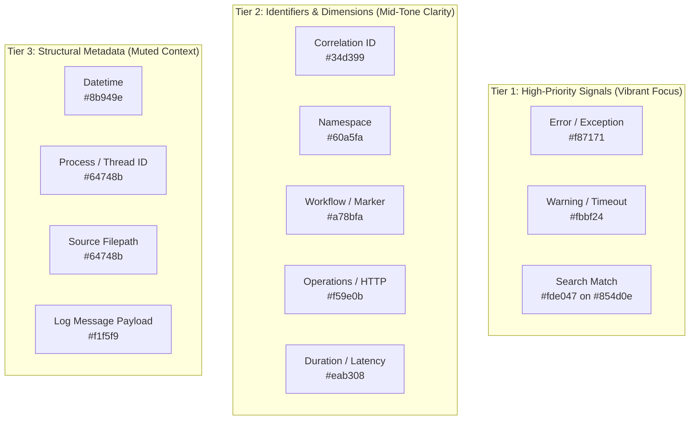

# LogViewer Design System (DESIGN.md)

> **Theme**: Obsidian Studio (Dark) & Warm Paper (Light)  
> **Target Audience**: Systems Engineers, Site Reliability Engineers, and Backend Developers  
> **Design Philosophy**: High-Density Precision Tooling, Zero "AI Slop", Intentional Semantic Hierarchy, Low-Fatigue Triage  

---

## 1. Design Philosophy & Anti-Slop Principles

Generic AI interface templates rely on saturated navy backgrounds, neon cyan text, glowing cyan-to-purple gradients, and high-saturation "rainbow soup" tokens. In a high-throughput developer log viewer where thousands of rows scroll at 60 FPS, those anti-patterns cause intense retinal fatigue and mask critical anomalies.

LogViewer adheres to four foundational design principles:

1. **Neutral Grounding Over Chromatic Vibration**:
   - The dark canvas recedes into neutral graphite and carbon blacks (`#0b0c10`, `#101216`, `#17191e`). Zero artificial blue-tinted haze (`#080c14`).
2. **Intentional Semantic Hierarchy**:
   - High-frequency structural metadata (timestamps, process IDs, thread IDs) is intentionally subdued (`#8b949e`, `#64748b`) so it does not compete for attention.
   - Low-frequency, high-importance signals (errors, warnings, search query matches) command immediate visual prominence.
3. **Restrained Engineering Brand & Outline Architecture**:
   - Zero solid-filled colored blocks/cells in dark mode. Primary action cells (e.g. `Load Files`, `.sidebar-logo`, `.btn-open-file`) use transparent or neutral backgrounds with marked 1px accent borders (`border: 1px solid var(--accent-primary)`).
   - No gradient text clippings or glowing drop shadows. Solid typography and crisp structural lines.
4. **Spatial Efficiency & Zero-Waste Layout**:
   - Dynamic gutters scale to file magnitude (e.g. 30px for 1–2 digit logs).
   - Fast-action buttons consume 0px layout footprint when idle via hover transitions (`position: absolute` / `display: none`).
   - Single-line navigation prevents wrapping jumps in Tier 2 filter toolbars.

---

## 2. Color System & Design Tokens

### 2.1 Obsidian Studio (Dark Theme - Default)

```css
:root {
  /* Canvas & Surfaces */
  --bg-app: #0b0c10;              /* Main application viewport base */
  --bg-sidebar: #101216;          /* Grounded left drawer navigation */
  --bg-surface: #17191e;          /* Elevated card and table row container */
  --bg-surface-hover: #20232a;    /* Interactive row and button hover state */
  --bg-card: #14161b;             /* Modal surface and telemetry card background */
  --bg-card-alt: #1a1d24;         /* Secondary panel background */
  
  /* Borders & Dividers */
  --border-subtle: rgba(255, 255, 255, 0.07);
  --border-highlight: rgba(255, 255, 255, 0.14);

  /* Typography */
  --text-primary: #f1f5f9;        /* High-contrast log messages & headers */
  --text-secondary: #94a3b8;      /* Secondary descriptions & metrics */
  --text-muted: #64748b;          /* Punctuation & subtle labels */

  /* Accents */
  --accent-primary: #3b82f6;      /* Engineering cobalt */
  --accent-hover: #2563eb;        /* Focused action hover */
  --accent-bg: rgba(59, 130, 246, 0.12); /* Subtle pill & badge tint */

  /* Selection States */
  --row-selected-bg: rgba(59, 130, 246, 0.12);
  --row-selected-border: #3b82f6;
  --row-hover-bg: rgba(255, 255, 255, 0.035);
  --gutter-selected-bg: rgba(23, 25, 30, 0.98);
  --gutter-selected-text: #60a5fa;
}
```

### 2.2 Warm Paper (Light Theme)

```css
[data-theme='light'] {
  --bg-app: #f8fafc;
  --bg-sidebar: #f1f5f9;
  --bg-surface: #ffffff;
  --bg-surface-hover: #e2e8f0;
  --bg-card: #ffffff;
  --bg-card-alt: #f8fafc;

  --border-subtle: #e2e8f0;
  --border-highlight: #cbd5e1;

  --text-primary: #0f172a;
  --text-secondary: #475569;
  --text-muted: #94a3b8;

  --accent-primary: #0284c7;
  --accent-hover: #0369a1;
  --accent-bg: rgba(2, 132, 199, 0.08);

  --row-selected-bg: rgba(2, 132, 199, 0.08);
  --row-selected-border: #0284c7;
  --row-hover-bg: rgba(15, 23, 42, 0.03);
}
```

---

## 3. Log Syntax & Semantic Token Hierarchy

To maintain optical comfort across 10,000+ line logs, tokens are categorized into three visual tiers:



| Token Variable | Dark Mode Hex | Light Mode Hex | Purpose & Usage |
| :--- | :--- | :--- | :--- |
| `--tok-datetime` | `#8b949e` (Slate) | `#0284c7` (Sky) | ISO-8601 & flat timestamps. Subdued to reduce line glare. |
| `--tok-pid` | `#64748b` (Slate) | `#78716c` (Stone) | Process ID, Thread ID brackets `[1042]`. |
| `--tok-corr` | `#34d399` (Mint) | `#059669` (Emerald) | Distributed tracing correlation IDs. |
| `--tok-namespace` | `#60a5fa` (Steel) | `#0369a1` (Ocean) | Application package / service namespace. |
| `--tok-workflow` | `#a78bfa` (Iris) | `#7c3aed` (Violet) | Workflow markers `[WF:Checkout]`. |
| `--tok-op-http` | `#f59e0b` (Amber) | `#ea580c` (Orange) | HTTP verbs `GET`, `POST`, `PUT`, `DELETE`. |
| `--tok-op-action`| `#fbbf24` (Gold) | `#d97706` (Amber) | Action verbs `Execute`, `Dispatch`. |
| `--tok-status-error`| `#f87171` (Crimson) | `#dc2626` (Red) | `ERROR`, `CRITICAL`, `FAILED`, `500`. |
| `--tok-status-warn` | `#fbbf24` (Amber) | `#d97706` (Amber) | `WARN`, `DEPRECATED`, `SLOW`. |
| `--tok-status-success`| `#4ade80` (Sage) | `#16a34a` (Green) | `SUCCESS`, `OK`, `200`. |
| `--tok-status-info` | `#60a5fa` (Sky) | `#0284c7` (Sky) | `INFO`, `NOTICE`. |
| `--tok-duration` | `#eab308` (Gold) | `#b45309` (Ochre) | Execution elapsed durations `142ms`. |
| `--tok-file` | `#64748b` (Slate) | `#78716c` (Stone) | Trailing code locations `[server.ts:42]`. |
| `--tok-msg` | `#f1f5f9` (Bright) | `#1c1917` (Charcoal) | Message text payload. |

---

## 4. Typography & Monospace Density

- **UI Sans Font**: `'Inter', -apple-system, BlinkMacSystemFont, 'Segoe UI', Roboto, sans-serif`
  - Used for topbars, buttons, tooltips, dialogs, and navigation drawers.
  - Tracking: `-0.015em` to `-0.02em` for crisp rendering at small point sizes (12px–13px).
- **Code & Log Mono Font**: `'Fira Code', 'JetBrains Mono', Menlo, Monaco, Consolas, monospace`
  - Font features: `calt`, `liga 0` (deliberately disabled in logs to avoid misleading arrow transformations in regex).
  - Row line-height: `1.38` for high density without visual collision between adjacent rows.

---

## 5. Layout Density & Spatial Rhythm

### 5.1 Sidebar Navigation
- **Width**: `300px` (provides adequate clearance for deep file paths and rotation badges).
- **Header**: High-density header (`10px 12px`) with outline branding (`.sidebar-logo`: transparent background, marked 1px accent border) and a 2-row quick-action grid:
  - Row 1: `Load Files` (`.btn-load-files`) + `Paste Logs` (`.btn-paste-logs`) sharing uniform neutral outline borders (`var(--border-subtle)`) and subtle hover surfaces.
  - Row 2: `Merge All Sources` (`.btn-merge-all`: outline multi-source toggle)
- **Item Rows**:
  - Height: `28px` with `padding: 3px 6px`.
  - Copy button: Zero layout reservation when idle (`display: none`), appears seamlessly on row hover (`display: inline-flex`).
  - Size badge: 2-line compact badge (`.source-size-badge`) showing count and unit.
  - Rotation indicator: `(🕒 N >)` for rotated log files.

### 5.2 Dynamic Line Number Gutter
- Gutter width dynamically calculates in [LogTable.tsx](file:///Users/amansaxena/Documents/Claude/Projects/LogViewer/src/components/LogTable.tsx):
  $$\text{Width} = \max(30\text{px}, \text{digitCount} \times 8 + 14\text{px})$$
- Scales seamlessly from `30px` (1–99 lines) up to `66px+` (100,000+ lines), eliminating up to 50% of unused blank void.
- Fast copy button is absolutely positioned (`position: absolute; left: 2px;`) consuming zero flex layout space when idle.

### 5.3 Topbar Tier Architecture & Single-Line Enclosure
- **Tier 1 (Sources & Telemetry)**: Breadcrumbs, dual velocity meters (`N/s` burst + `N/s avg`), live tail toggle, telemetry drawer button.
- **Tier 2 (Filters & Facets)**:
  - Enforced single-line flex container (`flex-wrap: nowrap; overflow-x: auto; scrollbar-width: none;`).
  - Severity pills (`ALL`, `ERROR`, `WARN`, `INFO`, `AUDIT`, `DEBUG`, `TRACE`) with negative exclusion triggers (`-`).
  - Dimension facet dropdowns (`Workflows`, `Operations`, `Correlation IDs`).
- **Tier 3 (Search & Presets)**:
  - Dual query inputs (Marker Regex + Fulltext Search).
  - Presets dropdown and quick search history recall (last 3 items).

---

## 6. Stacking Context & Z-Index Hierarchy

To eliminate visual clipping, overlay trapping, and tooltip corruption, the application enforces a strict z-index stacking model:

| Level / Layer | `z-index` | Description |
| :--- | :--- | :--- |
| **Gutter Base** | `5` | Sticky virtual line number column |
| **Sidebar Drawer** | `10` | Collapsible sources list |
| **Main Content** | `20` | Virtualized log scroll viewport |
| **Floating HUDs** | `40` | Delta Time latency toolbar & text selection action bar |
| **Topbar Tier** | `90` | Pinned multi-tier control bar |
| **Dropdown Popovers** | `100` | Search history, presets list, facet selectors |
| **Inspector Modals** | `1,000` | JSON/XML beautifier, Context lines modal |
| **System Diagnostics** | `2,000` | System health & SLA percentile modal |
| **Tooltips** | `100,000` | Global floating tooltips (`data-tooltip-align="left"`) |

---

## 7. Product Storytelling Landing Page Specification (Obsidian Studio Relay)

The product landing page ([LandingPage.tsx](file:///Users/amansaxena/Documents/Claude/Projects/LogViewer/src/components/LandingPage.tsx), [src/landing.css](file:///Users/amansaxena/Documents/Claude/Projects/LogViewer/src/landing.css)) extends the **Obsidian Studio** design system into a scroll-choreographed product storytelling narrative inspired by GetLayers Relay:

1. **Color & Border Architecture**:
   - Canvas: Neutral carbon black `#0b0c10` (`--lv-bg-void`), grounded drawer `#101216` (`--lv-bg-panel`), and elevated surface `#14161b` (`--lv-bg-surface`).
   - Primary Accent: **Engineering Cobalt** (`#3b82f6` / `#60a5fa`) with marked 1px structural borders (`border: 1px solid var(--lv-accent)`) and zero solid-filled pill slop.
   - Authentic Semantic Tokens: Uses the exact `--tok-*` palette (`#8b949e` datetime, `#34d399` correlation, `#60a5fa` namespace, `#a78bfa` workflow, `#f59e0b` HTTP operation, `#f87171` error, `#fbbf24` warn, `#eab308` duration).
2. **Signature Evolving Storytelling Elements**:
   - **Continuous Signal Conduit Spine**: A vertical 1px telemetry trace line along the left viewport rail with a scroll-linked diamond packet tracking narrative progression across stages.
   - **Stage 01 — 3D Interactive Instrument Hero**: Asymmetric split hero pairing concise engineering copy and a live scenario selector with a mouse-tracked 3D tilting Obsidian Studio workbench (complete with Tier 1 velocity meters, Tier 2 single-line severity & negative `-` exclusion pills, Tier 3 comma-AND search, live range-selection $\Delta t$ calculation, inline JSON/XML payload inspection, and a full `Viewer.png` capture toggle).
   - **Stage 02 — Seven-Layer Telemetry Evolution Deck**: Auto-evolving and interactive sticky mechanical hardware stage that unfolds across all seven layers of the `main` branch pipeline:
     1. *Layer 01*: Multi-Source Unified Stream & Rotation Hierarchy (`server/fileReader.ts`, `Sidebar.tsx`, `PasteLogsModal.tsx`) with animated SVG K-Way merge packet conduits.
     2. *Layer 02*: Permissive Bracket & Multi-Format Heuristic Tokenizer (`server/parser.ts`, `coloredLogRenderer.tsx`) with a continuous laser scanner beam and `[ ]` bracket stripper toggle.
     3. *Layer 03*: 3-Tier Topbar & Single-Line Facet Engine (`src/components/Topbar.tsx`) with negative (`-`) exclusion toggle, `Workflows`/`Operations`/`Correlations` facets, and comma-AND search.
     4. *Layer 04*: Embedded Entity Highlighter & Collapsible AST Tree Inspector (`messageContextHighlighter.tsx`, `JsonXmlInspectorModal.tsx`) with synchronized line gutters.
     5. *Layer 05*: Automatic Range Selection Delta Time ($\Delta t$) (`DeltaTimeToolbar.tsx`), `TextSelectionToolbar`, and $\pm 20$ line `ContextModal`.
     6. *Layer 06*: JSON-Driven Filter Presets (`PresetModal.tsx`, `config/presets.json`), `CompactLogRow` vs `LogRow` density toggle, and 20-char `CopyToast`.
     7. *Layer 07*: Constant-Memory 60 FPS Virtualization (`LogTable.tsx`) and Dual Runtime IPC Bridge (`src/api/bridge.ts`).
   - **Stage 03 — 3D Isometric Exploded Layer Stack**: Interactive 7-plate 3D isometric stack (`rotateX(14deg) rotateZ(-2deg)`) that elevates and unpacks telemetry SLA details on hover/selection.
   - **Stage 04 — 60 FPS Virtualization Engine & Vim Navigation Matrix**: Interactive 250,000-line `@tanstack/react-virtual` window scrubber demonstrating dynamic gutter scaling ($\max(30\text{px}, \text{digits} \times 8 + 14\text{px})$) alongside a live keyboard-driven Vim keycap matrix (`j`, `k`, `gg`, `G`, `/`, `Enter`, `Shift`, `?`).
